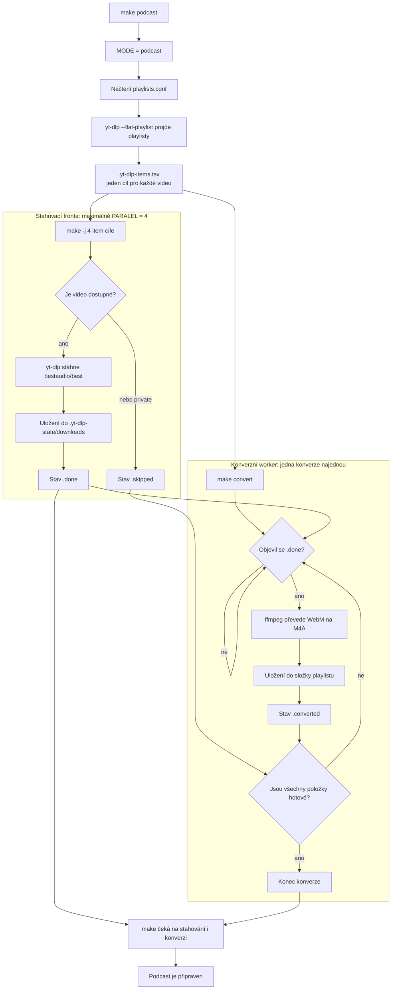

# Návod k použití

- [Návod k použití](#návod-k-použití)
  - [Instalace závislostí](#instalace-závislostí)
  - [Ukázka obsahu `playlists.conf`](#ukázka-obsahu-playlistsconf)
  - [Parámtery příkazu `yt-dlp`](#parámtery-příkazu-yt-dlp)
  - [Algoritmus pro stažení obsahu playlistů jako podcastu:](#algoritmus-pro-stažení-obsahu-playlistů-jako-podcastu)

## Instalace závislostí

Pro reprezentaci závislsotí se používá Nix. Pro instalaci závislostí spusťte příkaz:

```bash
nix-shell
```

Spustí se vám shell, jehož knihovny jsou oddělené od těch systémových.

```bash
========================================
Environment is ready.
yt-dlp version: 2026.08.19
Node.js version: v22.23.3
========================================
Run 'make' to start parallel downloads.
```

## Ukázka obsahu `playlists.conf`

Obsah soubory `playlists.conf`:
```conf
Společenstvo Prstenu - Kniha první - The Ring Sets Out | https://www.youtube.com/watch?v=_RvohVltJA0&list=PL9wib0YDd2dc8A5T8s4YWC6zDwtiJxUAi
Společenstvo Prstenu - Kniha druhá - The Ring Goes South | https://www.youtube.com/watch?v=oFHJmy12PJM&list=PL9wib0YDd2deT48AQ8oeAToZj-fJP_m2N
Dvě věže - Kniha třetí - The Treason of Isengard | https://www.youtube.com/watch?v=2MIEZDqzdVE&list=PL9wib0YDd2ddAFTbHHWZohe1SR0WguWVI
Dvě věže - Kniha čtvrtá - The Ring Goes East | https://www.youtube.com/watch?v=49ZREAe2yb4&list=PL9wib0YDd2ddRy5EmwFld3D0GYASoHERQ
```

Pro stažení obsahu playlistů jako podcastu - očíslovaný seznam epizod s metadaty a náhledy lze použít příkaz:

`make podcast`

```
Audio knihy a rozhlasové hry | https://www.youtube.com/watch?v=nOQZg-gMY3w&list=PLGoBJY8OzuQUrPQF5tIH6mWqxd2bAgvS9
Audioknihy v češtině - Narration Line | https://www.youtube.com/watch?v=D8ZvktGHtn0&list=PLc69hRr8hdoC9YoLciNfunXzV8PJLQapK
```
Pro stažení obsahu playlistů jako jednotlivé audioknihy - každý soubor zvlášt s výchozím jménem, použte příkaz:
`make audioknihy`

## Parámtery příkazu `yt-dlp`
Příkaz:
```bash
yt-dlp \
    --js-runtimes node \
    --extract-audio \
    --audio-format m4a \
    --embed-metadata \
    --embed-thumbnail \
    --output "$$NAME/%(playlist_index)02d - %(title)s.%(ext)s" \
    "$$URL"
```

Stáhny videa z playlistu $URL a ulož je do složky $NAME. Videa budou pojmenována podle indexu v playlistu a názvu videa, s příponou .m4a. Metadata a náhledy budou vloženy do souborů.

## Algoritmus pro stažení obsahu playlistů jako podcastu:

